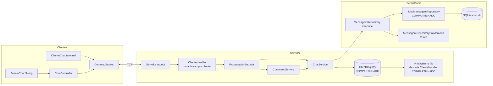
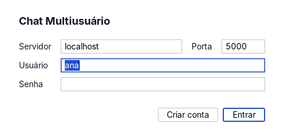
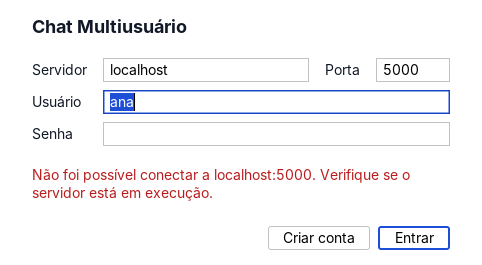
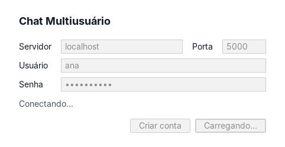
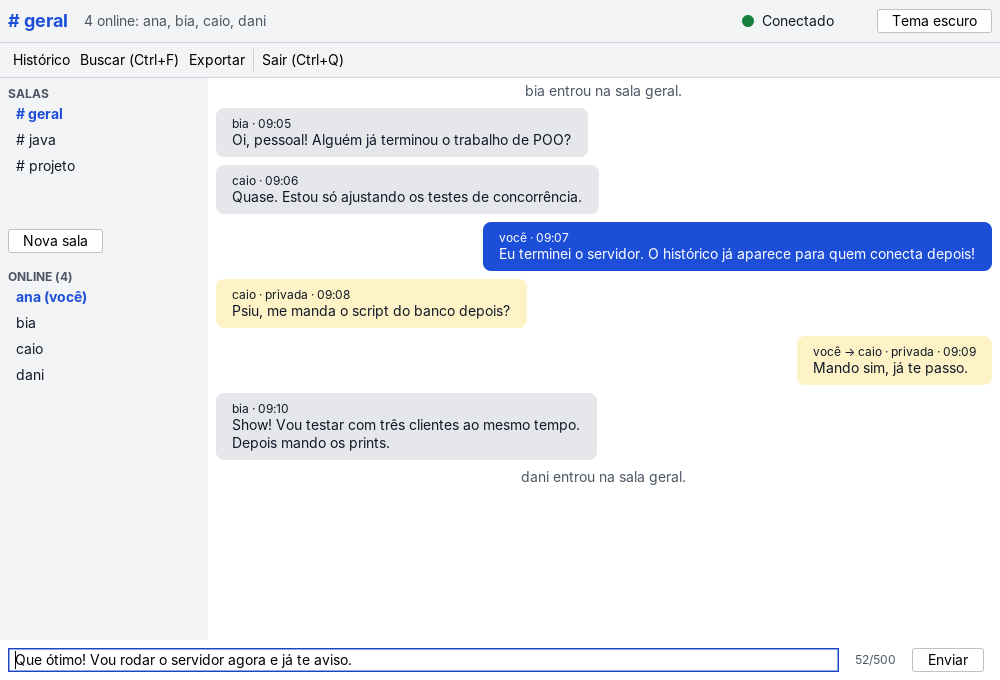
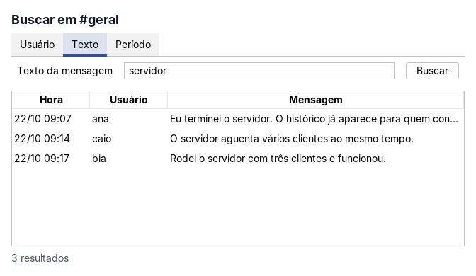
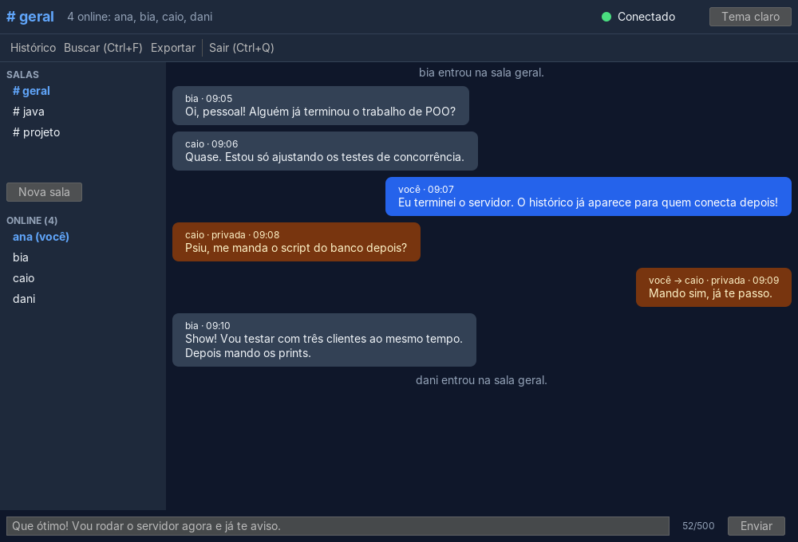
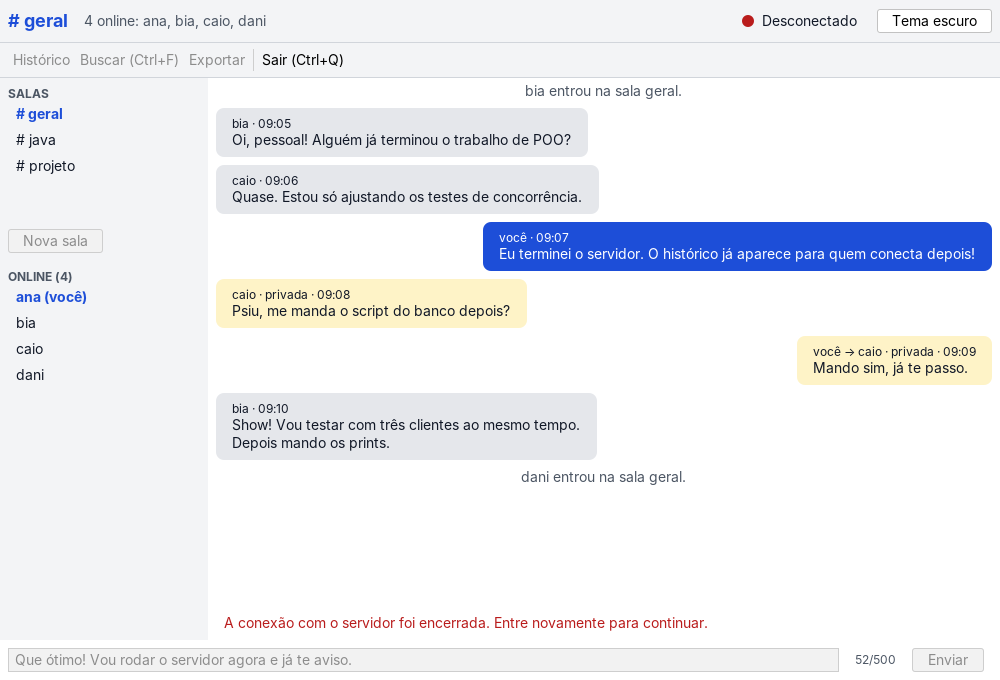

# Chat Multiusuário com Histórico

Projeto da disciplina de Programação Orientada a Objetos. É um chat cliente-servidor em Java 21: o servidor atende vários clientes ao mesmo tempo (uma thread por conexão), distribui as mensagens a todos e guarda o histórico em SQLite por JDBC. Há um cliente de terminal e um cliente gráfico (Swing com FlatLaf).

Outros documentos: [relatório](docs/RELATORIO.md), [roteiro do vídeo](docs/ROTEIRO_VIDEO.md), [perguntas sobre concorrência](docs/PERGUNTAS_CONCORRENCIA.md), [revisões](docs/REVISOES.md) e regras do projeto em [AGENTS.md](AGENTS.md).

## Requisitos

### Núcleo (obrigatório)

- Servidor com `ServerSocket` e `accept` em laço, uma thread por cliente (`ClienteHandler` implementa `Runnable`).
- Registro de clientes sincronizado (`ClientRegistry`) e broadcast para todos.
- `Mensagem` persistida por JDBC, com o SQL isolado em um `Repository`.
- Histórico enviado ao cliente quando ele conecta.
- Desconexão abrupta de um cliente não derruba o servidor.
- Testes unitários sem rede e sem banco real.
- Script `sql/criar_tabelas.sql`.

### Extras implementados

- Lista de usuários online e avisos de entrada e saída.
- Comandos `/help`, `/users`, `/history`, `/quit`.
- Validação de 500 caracteres e formatação `[HH:mm] nome: texto`.
- Mensagens privadas (`/msg`).
- Busca por usuário, texto e período (`/buscar`).
- Salas (`/join`, `/leave`, `/rooms`).
- Autenticação com PBKDF2 e salt (`/register`, `/login`).
- Exportação do histórico (`/exportar`) e log em arquivo, sem o conteúdo das mensagens privadas.
- Interface gráfica com tema claro e escuro.

### Rubrica (5,0 pontos)

| Critério | Pontos |
|---|---|
| Servidor atende vários clientes | 1,3 |
| Broadcast sem perder nem corromper mensagens | 1,2 |
| Persistência com JDBC | 1,0 |
| Pacotes e responsabilidades | 0,5 |
| Testes unitários | 0,5 |
| Código e relatório | 0,5 |

A autoavaliação com evidências, arquivo e linha está em [docs/REVISOES.md](docs/REVISOES.md), seção 4.

## Como compilar e rodar

Requisitos: Java 21 e Maven.

```
mvn test                      # todos os testes
xvfb-run -a mvn test          # inclui os testes de janela (Linux sem tela)
mvn package -DskipTests       # gera target/chat-multiusuario-1.0.0.jar e target/lib/
mvn javadoc:javadoc           # Javadoc em target/site/apidocs
```

Servidor (porta 5000 e arquivo `chat.db` por padrão):

```
java -cp target/chat-multiusuario-1.0.0.jar br.unicesumar.chat.ServidorMain [porta] [arquivo.db] [--sem-autenticacao]
```

Cliente de terminal:

```
java -cp target/chat-multiusuario-1.0.0.jar br.unicesumar.chat.ClienteTerminalMain [servidor] [porta]
```

Cliente gráfico:

```
java -cp target/chat-multiusuario-1.0.0.jar br.unicesumar.chat.ClienteGuiMain
```

O `.jar` precisa ficar ao lado da pasta `target/lib`, onde estão o SQLite e o FlatLaf. O servidor cria `chat.db`, `logs/servidor.log` e `exportacoes/` na pasta onde for iniciado. Esses arquivos não são versionados.

Primeiro acesso: `/register nome senha` cria a conta e já entra. Depois, `/login nome senha`. O nome tem de 3 a 20 letras, números ou `_`, e a senha de 6 a 128 caracteres.

### Comandos

| Comando | O que faz |
|---|---|
| `/help` | Lista os comandos |
| `/users` | Usuários online na sua sala |
| `/history [quantidade]` | Últimas mensagens da sala |
| `/msg usuario texto` | Mensagem privada |
| `/buscar usuario <nome>` | Mensagens de um usuário |
| `/buscar texto <trecho>` | Mensagens que contêm o trecho |
| `/buscar periodo <AAAA-MM-DD> <AAAA-MM-DD>` | Mensagens entre duas datas |
| `/join sala`, `/leave`, `/rooms` | Entrar em uma sala, voltar para a geral, listar salas |
| `/exportar` | Grava o histórico da sala em um `.txt` no servidor |
| `/quit` | Sai do chat |

## Arquitetura em camadas

Pacote base: `br.unicesumar.chat`. A tabela completa de pacotes está em [AGENTS.md](AGENTS.md).



Estado compartilhado entre threads (marcado como COMPARTILHADO): `ClientRegistry` (lista de clientes, protegida por lock), `ChatService` (a ordem "salvar e transmitir" é serializada por um lock), os repositórios (uma `Connection` por operação, WAL e `busy_timeout`) e a escrita de cada `ClienteHandler` (`enviar` sincronizado mais uma fila por cliente).

Regras de dependência: `model` não conhece rede, banco nem tela. O socket não conhece SQL. O repositório não conhece socket. O `ChatService` depende da interface `MensagemRepository`, e a implementação JDBC é injetada em `ServidorMain`. O `ChatController` não importa `javax.swing` e nenhum cliente conhece repositório. Cada interface tem um adaptador real e um falso (memória e `ConexaoFalsa`).

## Linguagem ubíqua

| Termo | Classe |
|---|---|
| Usuário | `model.Usuario` |
| Mensagem | `model.Mensagem` |
| Mensagem privada | `Mensagem.privada(...)` e `ChatService.enviarPrivada` |
| Sala | `model.Sala` e `server.SalaService` |
| Histórico | `MensagemRepository.buscarUltimas` |
| Credencial | `model.CredencialUsuario` e `server.AuthService` |
| Transmitir (broadcast) | `ClientRegistry.transmitir` |
| Cliente conectado | `server.ClienteHandler` |

### Tipos do domínio

- `Usuario` é uma **entidade**: é identificado pelo nome, e dois usuários com o mesmo nome (sem diferenciar maiúsculas) são o mesmo.
- `Mensagem` é um **objeto de valor imutável**: depois de criada não muda, tem no máximo 500 caracteres e é comparada pelo conteúdo.
- `Sala` é a **raiz do agregado**: é por ela que se entra e se sai de uma sala. O nome tem de 1 a 20 caracteres (`a-z`, `0-9`, `_`) e a sala padrão se chama `geral`.

## Revisão de concorrência

A revisão foi feita em modo revisor, com arquivo e linha, e está completa em [docs/REVISOES.md](docs/REVISOES.md) (seção 1). Resumo do que foi apontado e do que foi decidido:

| O que a revisão apontou | O que decidimos |
|---|---|
| Lista de clientes lida e alterada por várias threads | Todo acesso sob um lock privado. Quem percorre trabalha em uma cópia. |
| Duas threads transmitindo ao mesmo tempo poderiam entregar em ordens diferentes | `ChatService` serializa "salvar e transmitir". Todos veem a mesma ordem. |
| Escrita lenta em um socket seguraria todos os outros | Fila por cliente e thread de escrita. Cliente que passa de 256 KB é desconectado. |
| Cliente removido durante o broadcast | `enviar` devolve `false`, o cliente é removido e os outros não são afetados. |
| Conexão aceita logo depois de `parar()` | `parar()` espera a thread de accept e descarta o socket tardio (corrigido). |
| Dois logins com o mesmo nome ao mesmo tempo | `identificar` é atômico e o cadastro usa `UNIQUE` no banco. |
| Gravar dentro do lock deixa o envio mais lento | Mantido: a ordem igual para todos é o requisito. |
| Duas exceções engolidas | Passaram a ir para o log (corrigido). |

Os testes de concorrência usam 8 threads, `@RepeatedTest(10)` e `CountDownLatch`, sem `Thread.sleep`.

## Onde a IA foi usada e como foi validada

- A IA (Claude) escreveu o código e os testes em etapas, seguindo TDD: primeiro o teste falhando, depois o mínimo de código, depois a refatoração.
- Cada etapa terminou com `mvn test` verde e um commit.
- A IA também fez as revisões de concorrência, JDBC, arquitetura e usabilidade, e cada achado virou um teste ou uma decisão registrada.
- Validação: executei a suíte repetidas vezes, rodei servidor e três clientes de verdade, olhei as capturas de tela da interface e comparei o resultado com a rubrica.
- Teste que falhou nunca foi alterado só para passar. Quando a mudança era legítima (avisos de entrada e saída), eu autorizei antes.

## Condição de corrida: o que acontece e a prova

Sem sincronização, duas threads fazem `contador++` ao mesmo tempo: as duas leem o mesmo valor, as duas somam um e uma das somas se perde. O resultado fica menor que o esperado. Com `synchronized` ou `AtomicLong`, cada incremento acontece por inteiro e o total fecha.

Demonstração em `src/test/java/br/unicesumar/chat/demo/CorridaDeDados.java` (duas threads, 1.000.000 de incrementos cada, esperado 2.000.000):

```
Antes (sem sincronização)            Depois
Rodada 1: 1950533                    COM synchronized: 2000000
Rodada 2: 1196893                    COM AtomicLong:   2000000
Rodada 3: 1983247
Rodada 4: 1994274
Rodada 5: 2000000
```

Para repetir:

```
mvn -q test-compile
mvn -q dependency:build-classpath -Dmdep.outputFile=/tmp/cp.txt
java -cp "target/classes:target/test-classes:$(cat /tmp/cp.txt)" br.unicesumar.chat.demo.CorridaDeDados
```

No chat, o mesmo problema aconteceria na lista de clientes, e é por isso que ela fica atrás de um lock.

## Telas

Login:



Erro de login:



Conectando:



Chat, tema claro:



Busca:



Chat, tema escuro:



Chat desconectado:



## Estado dos testes e limitações

- 905 testes. Sem tela, os 17 testes de janela são ignorados; com `xvfb-run -a mvn test` todos rodam.
- Todos os testes passam. O teste da sala (`SalaServiceTest.falhaAoBuscarOHistoricoNaoMudaASalaNemAvisaNinguem`) usava um repositório falso que só falhava ao gravar, e o cenário pede falha ao ler. O defeito era do teste e foi corrigido com um repositório falso que falha na leitura.
- A senha trafega em texto puro, porque não há TLS. O hash PBKDF2 protege só o que fica gravado no banco.
- Quando se está lendo mensagens antigas, a janela não avisa que chegaram mensagens novas.
- Cliente que some sem aviso só é detectado pela fila de escrita ou pelo TCP (não há keep-alive).
