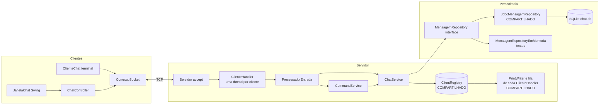
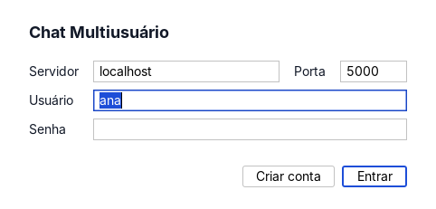
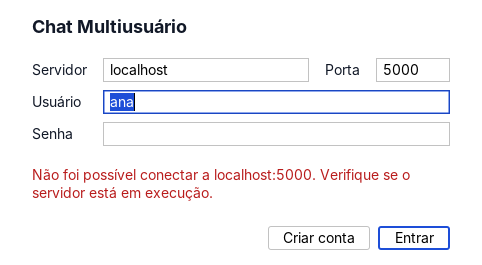
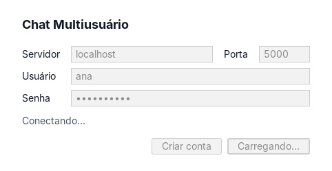
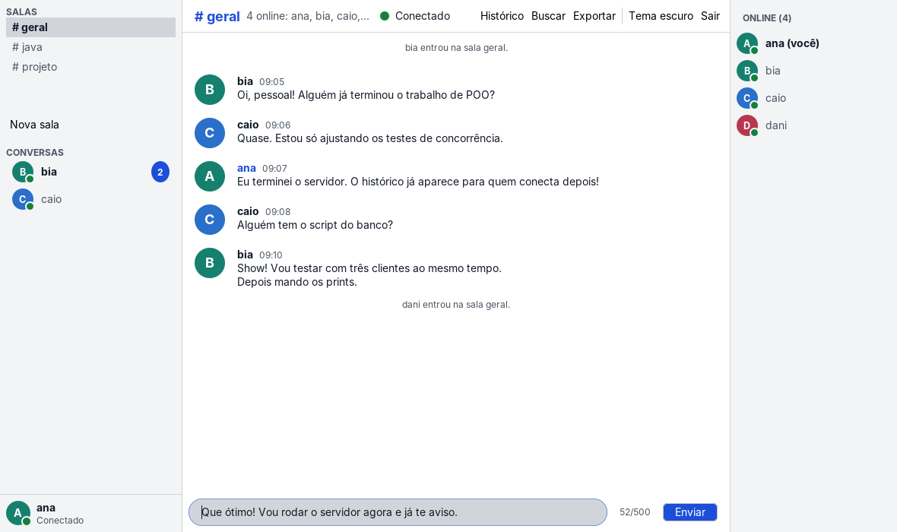
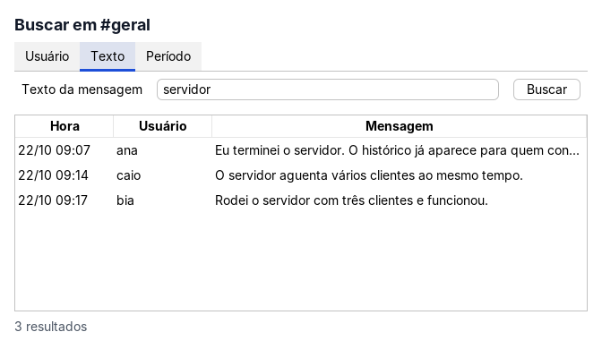
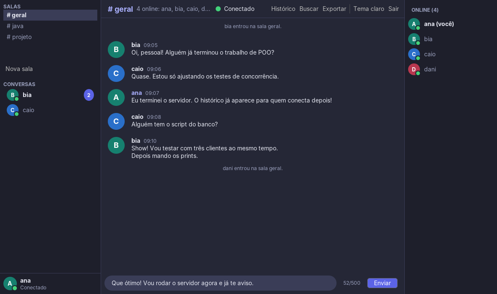
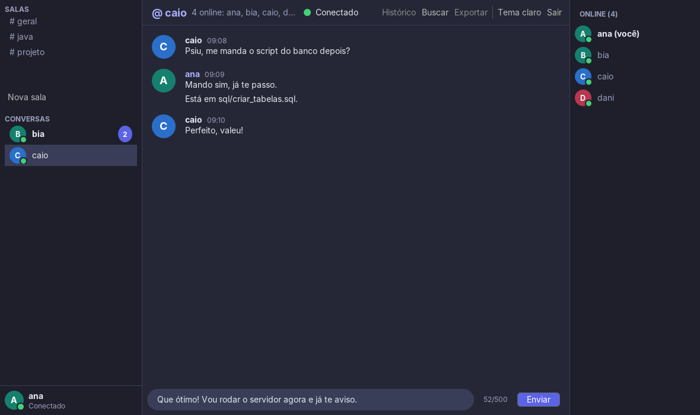
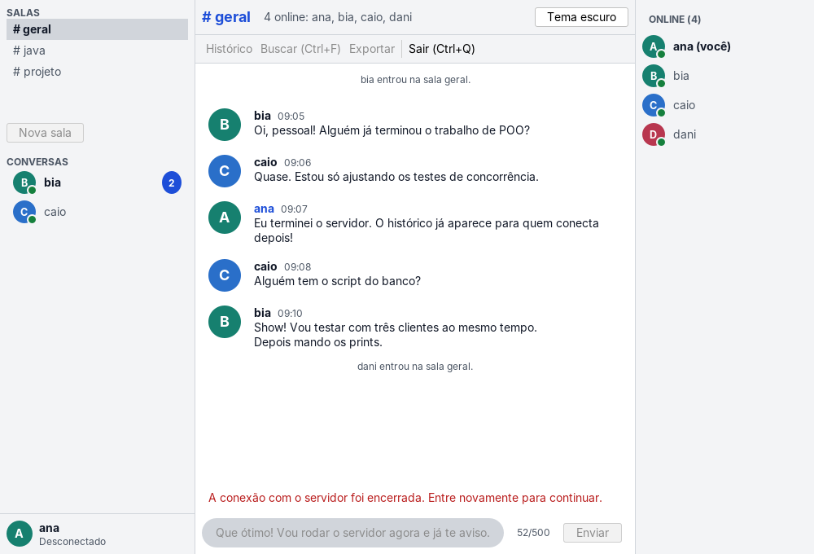

# Chat Multiusuário com Histórico

Projeto da disciplina de Programação Orientada a Objetos. É um chat cliente-servidor em Java 21: o servidor atende vários clientes ao mesmo tempo (uma thread por conexão), distribui as mensagens a todos e guarda o histórico em SQLite por JDBC. Há um cliente gráfico (Swing com FlatLaf) e um cliente de terminal.

Vídeo de demonstração: [docs/video/demonstracao.mp4](docs/video/demonstracao.mp4) (3 clientes conectados, sem áudio).

## Sumário

1. [Baixar o projeto](#1-baixar-o-projeto)
2. [Instalar o Java 21](#2-instalar-o-java-21)
3. [Executar o chat](#3-executar-o-chat)
4. [Usar o chat e comandos](#4-usar-o-chat-e-comandos)
5. [Rodar os testes](#5-rodar-os-testes)
6. [Problemas comuns](#6-problemas-comuns)
7. [Requisitos e rubrica](#7-requisitos-e-rubrica)
8. [Arquitetura](#arquitetura-em-camadas) e demais seções

## 1. Baixar o projeto

Escolha uma das opções.

**Com Git:**

```
git clone https://github.com/JoaoLucasVeiga/TrabalhoPOO2bimestre.git
cd TrabalhoPOO2bimestre
```

**Sem Git:** na página do repositório, clique em **Code > Download ZIP** e descompacte o arquivo. Abra a pasta descompactada.

## 2. Instalar o Java 21

Só o **Java 21 (JDK) ou mais novo** é necessário. Não precisa instalar Maven, banco de dados nem Node.

Confira se já está instalado, abrindo um terminal (no Windows, o Prompt de Comando) e digitando:

```
java -version
```

Se aparecer `21` ou um número maior, siga adiante. Se aparecer um número menor ou "comando não encontrado", instale o JDK 21 em https://adoptium.net (escolha "Temurin 21") e abra um terminal novo.

## 3. Executar o chat

Na pasta do projeto, use os atalhos. Na primeira vez eles compilam o projeto sozinhos pelo Maven Wrapper (`mvnw`): baixa o Maven e leva cerca de um minuto, com internet. Nas vezes seguintes abrem direto.

**Mais rápido, no Windows:** dê dois cliques em `iniciar-tudo.bat`. Ele abre o servidor e 3 janelas do chat.

| Windows | Linux e macOS | O que abre |
|---|---|---|
| `iniciar-tudo.bat` | | Servidor e 3 janelas do chat |
| `iniciar-servidor.bat` | `./iniciar-servidor.sh` | Só o servidor (porta 5000) |
| `iniciar-cliente-grafico.bat` | `./iniciar-cliente-grafico.sh` | Uma janela do chat |
| `iniciar-cliente-terminal.bat` | `./iniciar-cliente-terminal.sh` | Cliente de terminal |

Para usar de outro jeito, abra primeiro o servidor e depois quantos clientes quiser.

**Na tela de login de cada janela:**

1. Servidor `localhost` e porta `5000` (já vêm preenchidos).
2. Escreva um usuário (3 a 20 letras, números ou `_`) e uma senha (6 a 128 caracteres).
3. Na primeira vez, clique em **Criar conta**. Nas próximas, clique em **Entrar**.
4. Use um usuário diferente em cada janela e converse entre elas.

O servidor cria na pasta onde foi iniciado o banco `chat.db`, o log `logs/servidor.log` e a pasta `exportacoes/`. Esses arquivos não são versionados. Para zerar o histórico, pare o servidor e apague o `chat.db`.

**Sem os atalhos (linha de comando):**

```
mvnw package -DskipTests       # no Linux/macOS: sh ./mvnw package -DskipTests
java -cp target/chat-multiusuario-1.0.0.jar br.unicesumar.chat.ServidorMain [porta] [arquivo.db] [--sem-autenticacao]
java -cp target/chat-multiusuario-1.0.0.jar br.unicesumar.chat.ClienteGuiMain
java -cp target/chat-multiusuario-1.0.0.jar br.unicesumar.chat.ClienteTerminalMain [servidor] [porta]
```

O `.jar` precisa ficar ao lado da pasta `target/lib`, onde estão o SQLite e o FlatLaf. Quem já tem Maven pode usar `mvn` no lugar de `mvnw`.

**Em outro computador da mesma rede:** no PC do servidor, descubra o IP (`ipconfig` no Windows). Nos outros PCs, abra o cliente e preencha esse IP em "Servidor", com a mesma porta. A senha trafega sem criptografia (sem TLS), por isso não exponha o servidor na internet.

### Administrador

O administrador é uma conta definida **na configuração do servidor, fora do código**. Sem essa configuração, ninguém é administrador e `/exportar`, `/kick` e `/limpar` ficam bloqueados.

1. Copie `servidor.properties.exemplo` para `servidor.properties`, na pasta onde o servidor roda (a raiz do projeto, se usar os atalhos).
2. Preencha `admin.usuario` e `admin.senha` (de 6 a 128 caracteres).
3. Inicie o servidor. Ele cria a conta na primeira vez e avisa no terminal. Se a conta já existir, a senha **não** é alterada.
4. Entre no chat com essa conta. Só ela vê o botão **Exportar** e pode usar os comandos de administração.

O `servidor.properties` está no `.gitignore` e não vai para o GitHub. Em vez do arquivo, dá para usar as variáveis de ambiente `CHAT_ADMIN_USUARIO` e `CHAT_ADMIN_SENHA`, que têm prioridade. O administrador não lê mensagens privadas. `/kick` só desconecta: a pessoa pode entrar de novo. Para impedir, use `/ban`, que vale também depois de reiniciar o servidor (fica no banco) e vale até para um nome que ainda não tem conta. Depois de `/limpar`, as telas que já estavam abertas mostram um aviso, mas só perdem as mensagens antigas ao reentrar na sala.

## 4. Usar o chat e comandos

No cliente gráfico, digite na caixa de baixo e pressione Enter. Duplo clique em um usuário da coluna da direita, ou clique em uma conversa da lista, abre a conversa privada com ele; clicar na sala volta ao chat da sala. Os comandos abaixo também valem na interface gráfica e no terminal.

| Comando | O que faz |
|---|---|
| `/help` | Lista os comandos |
| `/users` | Usuários online na sua sala |
| `/history [quantidade]` | Últimas mensagens da sala |
| `/msg usuario texto` | Mensagem privada (também para quem está offline, se tiver conta) |
| `/conversas` | Lista as suas conversas privadas |
| `/conversa usuario [quantidade]` | Mostra a sua conversa privada com um usuário |
| `/buscar usuario <nome>` | Mensagens de um usuário |
| `/buscar texto <trecho>` | Mensagens que contêm o trecho |
| `/buscar periodo <AAAA-MM-DD> <AAAA-MM-DD>` | Mensagens entre duas datas |
| `/join sala`, `/leave`, `/rooms` | Entrar em uma sala, voltar para a geral, listar salas |
| `/exportar` | Grava o histórico da sala em um `.txt` no servidor (somente administrador) |
| `/kick usuario` | Remove um usuário do chat (somente administrador) |
| `/limpar` | Apaga o histórico da sala atual (somente administrador) |
| `/ban usuario` | Bane: remove do chat e impede de entrar ou criar conta com esse nome (somente administrador) |
| `/unban usuario` | Tira o banimento (somente administrador) |
| `/bans` | Lista os banidos (somente administrador) |
| `/register nome senha`, `/login nome senha` | Criar conta ou entrar (no terminal) |
| `/quit` | Sai do chat |

Cada mensagem tem no máximo 500 caracteres e aparece como `[HH:mm] nome: texto`. Na interface gráfica, Ctrl+F abre a busca e Ctrl+Q sai.

## 5. Rodar os testes

```
mvnw test                     # todos os testes (no Linux/macOS: sh ./mvnw test)
xvfb-run -a mvn test          # inclui os testes de janela (Linux sem tela)
mvnw javadoc:javadoc          # Javadoc em target/site/apidocs
```

São 1125 testes. Os 17 testes de janela são ignorados quando não há tela.

## 6. Problemas comuns

| O que aparece | O que fazer |
|---|---|
| `java` não é reconhecido, ou "comando não encontrado" | Instale o JDK 21 (seção 2) e abra um terminal novo |
| `UnsupportedClassVersionError` | O Java instalado é mais antigo que o 21. Instale o 21 |
| `The JAVA_HOME environment variable is not defined correctly` | A variável `JAVA_HOME` do Windows aponta para uma pasta que não existe. Os atalhos atuais já corrigem isso sozinhos. Se ainda aparecer, defina na janela: `set JAVA_HOME=C:\caminho\do\jdk-21` e rode o atalho de novo |
| Falha ao compilar na primeira vez | Confira a internet e a versão do Java (`java -version`) e tente de novo |
| O cliente diz que não conseguiu conectar | O servidor não está aberto, ou a porta ou o endereço estão diferentes |
| Porta 5000 em uso | Inicie o servidor em outra porta (`ServidorMain 5001`) e use a mesma no login |
| O Windows pergunta sobre o firewall | Permita o acesso. Em `localhost` normalmente nem aparece |
| A janela do chat não abre no Windows | Rode `iniciar-cliente-terminal.bat` para ver a mensagem de erro |
| "O nome ... já está cadastrado" | A conta já existe. Clique em **Entrar** em vez de Criar conta |
| "Esta conta foi banida pelo administrador" | O administrador baniu essa conta. Peça a ele para usar `/unban` |
| "Somente o administrador pode usar ..." | O comando é de administração. Configure o administrador (seção 3, "Administrador") e entre com essa conta |
| "Falta a senha do administrador" | O `servidor.properties` tem `admin.usuario` sem `admin.senha` (ou o contrário). Preencha os dois |
| "O nome ... já está em uso" | Esse usuário já está online em outra janela. Use outro nome |

## 7. Requisitos e rubrica

### Núcleo (obrigatório)

- Servidor com `ServerSocket` e `accept` em laço, uma thread por cliente (`ClienteHandler` implementa `Runnable`).
- Registro de clientes sincronizado (`ClientRegistry`) e broadcast para todos.
- `Mensagem` persistida por JDBC, com o SQL isolado em um `Repository`.
- Histórico enviado ao cliente quando ele conecta.
- Desconexão abrupta de um cliente não derruba o servidor.
- Testes unitários sem rede e sem banco real.
- Script `sql/criar_tabelas.sql`.

### Extras implementados

- Lista de usuários online e avisos de entrada e saída.
- Comandos `/help`, `/users`, `/history`, `/quit`.
- Validação de 500 caracteres e formatação `[HH:mm] nome: texto`.
- Conversas privadas de verdade (`/msg`, `/conversas`, `/conversa`), com histórico por par de usuários, lista de conversas e contador de não lidas.
- Busca por usuário, texto e período (`/buscar`).
- Salas (`/join`, `/leave`, `/rooms`).
- Autenticação com PBKDF2 e salt (`/register`, `/login`).
- Exportação do histórico (`/exportar`) e log em arquivo, sem o conteúdo das mensagens privadas.
- Administrador definido por configuração (`/exportar`, `/kick`, `/limpar` e banimento com `/ban`, `/unban` e `/bans` só para ele).
- Interface gráfica em três colunas (salas e conversas, chat, membros), com avatares, mensagens em bloco e tema claro e escuro.

### Rubrica (5,0 pontos)

| Critério | Pontos |
|---|---|
| Servidor atende vários clientes | 1,3 |
| Broadcast sem perder nem corromper mensagens | 1,2 |
| Persistência com JDBC | 1,0 |
| Pacotes e responsabilidades | 0,5 |
| Testes unitários | 0,5 |
| Código e relatório | 0,5 |

A autoavaliação com evidências, arquivo e linha está em [docs/REVISOES.md](docs/REVISOES.md), seção 4.

Outros documentos: [relatório](docs/RELATORIO.md) (também em [Word](docs/Relatorio_Chat_Multiusuario.docx)), [roteiro do vídeo](docs/ROTEIRO_VIDEO.md), [perguntas sobre concorrência](docs/PERGUNTAS_CONCORRENCIA.md), [revisões](docs/REVISOES.md) e regras do projeto em [AGENTS.md](AGENTS.md).

## Arquitetura em camadas

Pacote base: `br.unicesumar.chat`. A tabela completa de pacotes está em [AGENTS.md](AGENTS.md).



Estado compartilhado entre threads (marcado como COMPARTILHADO): `ClientRegistry` (lista de clientes, protegida por lock), `ChatService` (a ordem "salvar e transmitir" é serializada por um lock), os repositórios (uma `Connection` por operação, WAL e `busy_timeout`) e a escrita de cada `ClienteHandler` (`enviar` sincronizado mais uma fila por cliente).

Regras de dependência: `model` não conhece rede, banco nem tela. O socket não conhece SQL. O repositório não conhece socket. O `ChatService` depende da interface `MensagemRepository`, e a implementação JDBC é injetada em `ServidorMain`. O `ChatController` não importa `javax.swing` e nenhum cliente conhece repositório. Cada interface tem um adaptador real e um falso (memória e `ConexaoFalsa`).

## Linguagem ubíqua

| Termo | Classe |
|---|---|
| Usuário | `model.Usuario` |
| Mensagem | `model.Mensagem` |
| Mensagem privada | `Mensagem.privada(...)` e `ChatService.enviarPrivada` |
| Sala | `model.Sala` e `server.SalaService` |
| Histórico | `MensagemRepository.buscarUltimas` |
| Credencial | `model.CredencialUsuario` e `server.AuthService` |
| Transmitir (broadcast) | `ClientRegistry.transmitir` |
| Cliente conectado | `server.ClienteHandler` |

### Tipos do domínio

- `Usuario` é uma **entidade**: é identificado pelo nome, e dois usuários com o mesmo nome (sem diferenciar maiúsculas) são o mesmo.
- `Mensagem` é um **objeto de valor imutável**: depois de criada não muda, tem no máximo 500 caracteres e é comparada pelo conteúdo.
- `Sala` é a **raiz do agregado**: é por ela que se entra e se sai de uma sala. O nome tem de 1 a 20 caracteres (`a-z`, `0-9`, `_`) e a sala padrão se chama `geral`.

## Revisão de concorrência

A revisão foi feita em modo revisor, com arquivo e linha, e está completa em [docs/REVISOES.md](docs/REVISOES.md) (seção 1). Resumo do que foi apontado e do que foi decidido:

| O que a revisão apontou | O que decidimos |
|---|---|
| Lista de clientes lida e alterada por várias threads | Todo acesso sob um lock privado. Quem percorre trabalha em uma cópia. |
| Duas threads transmitindo ao mesmo tempo poderiam entregar em ordens diferentes | `ChatService` serializa "salvar e transmitir". Todos veem a mesma ordem. |
| Escrita lenta em um socket seguraria todos os outros | Fila por cliente e thread de escrita. Cliente que passa de 256 KB é desconectado. |
| Cliente removido durante o broadcast | `enviar` devolve `false`, o cliente é removido e os outros não são afetados. |
| Conexão aceita logo depois de `parar()` | `parar()` espera a thread de accept e descarta o socket tardio (corrigido). |
| Dois logins com o mesmo nome ao mesmo tempo | `identificar` é atômico e o cadastro usa `UNIQUE` no banco. |
| Gravar dentro do lock deixa o envio mais lento | Mantido: a ordem igual para todos é o requisito. |
| Duas exceções engolidas | Passaram a ir para o log (corrigido). |

Os testes de concorrência usam 8 threads, `@RepeatedTest(10)` e `CountDownLatch`, sem `Thread.sleep`.

## Onde a IA foi usada e como foi validada

- A IA (Claude) escreveu o código e os testes em etapas, seguindo TDD: primeiro o teste falhando, depois o mínimo de código, depois a refatoração.
- Cada etapa terminou com `mvn test` verde e um commit.
- A IA também fez as revisões de concorrência, JDBC, arquitetura e usabilidade, e cada achado virou um teste ou uma decisão registrada.
- Validação: executei a suíte repetidas vezes, rodei servidor e três clientes de verdade, olhei as capturas de tela da interface e comparei o resultado com a rubrica.
- Teste que falhou nunca foi alterado só para passar. Quando a mudança era legítima (avisos de entrada e saída), eu autorizei antes.

## Condição de corrida: o que acontece e a prova

Sem sincronização, duas threads fazem `contador++` ao mesmo tempo: as duas leem o mesmo valor, as duas somam um e uma das somas se perde. O resultado fica menor que o esperado. Com `synchronized` ou `AtomicLong`, cada incremento acontece por inteiro e o total fecha.

Demonstração em `src/test/java/br/unicesumar/chat/demo/CorridaDeDados.java` (duas threads, 1.000.000 de incrementos cada, esperado 2.000.000):

```
Antes (sem sincronização)            Depois
Rodada 1: 1950533                    COM synchronized: 2000000
Rodada 2: 1196893                    COM AtomicLong:   2000000
Rodada 3: 1983247
Rodada 4: 1994274
Rodada 5: 2000000
```

Para repetir:

```
mvn -q test-compile
mvn -q dependency:build-classpath -Dmdep.outputFile=/tmp/cp.txt
java -cp "target/classes:target/test-classes:$(cat /tmp/cp.txt)" br.unicesumar.chat.demo.CorridaDeDados
```

No chat, o mesmo problema aconteceria na lista de clientes, e é por isso que ela fica atrás de um lock.

## Telas

Login:



Erro de login:



Conectando:



Chat, tema claro:



Busca:



Chat, tema escuro:



Conversa privada:



Chat desconectado:



## Estado dos testes e limitações

- 1125 testes. Sem tela, os 17 testes de janela são ignorados; com `xvfb-run -a mvn test` todos rodam.
- Todos os testes passam. O teste da sala (`SalaServiceTest.falhaAoBuscarOHistoricoNaoMudaASalaNemAvisaNinguem`) usava um repositório falso que só falhava ao gravar, e o cenário pede falha ao ler. O defeito era do teste e foi corrigido com um repositório falso que falha na leitura.
- A senha trafega em texto puro, porque não há TLS. O hash PBKDF2 protege só o que fica gravado no banco.
- Quando se está lendo mensagens antigas, a janela não avisa que chegaram mensagens novas.
- Cliente que some sem aviso só é detectado pela fila de escrita ou pelo TCP (não há keep-alive).
