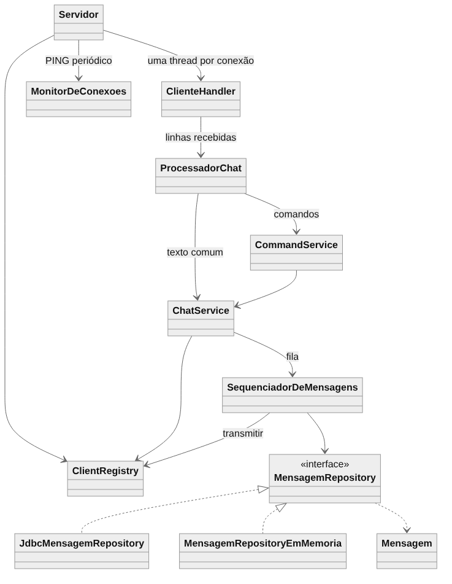
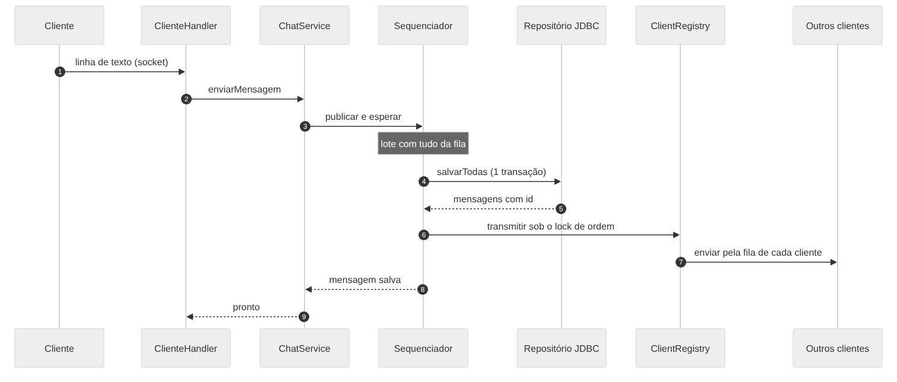

# Chat Multiusuário com Histórico

**Relatório de arquitetura e concorrência**

Programação Orientada a Objetos · 2º bimestre · github.com/JoaoLucasVeiga/TrabalhoPOO2bimestre

## 1. Visão geral

O projeto é um chat cliente-servidor em Java 21 que usa sockets TCP. O servidor aceita vários clientes ao mesmo tempo, retransmite cada mensagem para todos os conectados e grava o histórico em um banco SQLite por JDBC. Quando um cliente conecta, recebe as últimas mensagens já gravadas.

Além do núcleo pedido, o sistema tem lista de usuários online, conversas privadas com histórico, salas, busca no histórico, login com senha protegida por PBKDF2 e um administrador que exporta o histórico, remove, bane e limpa salas. A interface gráfica, em Swing, tem três colunas (salas e conversas, chat e membros), avatares, mensagens em bloco e um seletor de emojis, com figurinhas. A conexão pode ser criptografada com TLS, de forma opcional.

## 2. Arquitetura

O código está dividido em pacotes, e cada um tem uma responsabilidade:

- **model:** Usuario, Mensagem e Sala. É o domínio puro e não conhece rede, banco nem tela.

- **persistence:** as interfaces MensagemRepository (mensagens, conversas privadas e limpeza de sala), UsuarioRepository e BanimentoRepository. Todo o SQL fica nas implementações JDBC, em persistence.jdbc.

- **server:** Servidor, ClienteHandler, ClientRegistry e os serviços (ChatService, SequenciadorDeMensagens, MonitorDeConexoes, SalaService, AuthService, Administradores e PreparoDeAdmin). Os comandos ficam em classes por assunto (conta, sala, consulta, conversa e administração), e o CommandService só escolhe qual executar.

- **client:** o cliente de terminal, o controlador (que sabe se o usuário vê uma sala ou uma conversa privada) e as telas Swing (JanelaChat, PainelLateral, LinhaMensagem, AvatarIcon, Emojis e SeletorDeEmojis). Também há a demonstração de mensagens simultâneas (DemonstracaoSimultanea).

- **protocol e infra:** a codificação das linhas de texto trocadas pelo socket, e a exportação, o log em arquivo, a leitura da configuração do servidor e o certificado do TLS (CertificadoTls).

O caminho de uma mensagem é este:

1.  O cliente envia uma linha de texto pelo socket.

2.  O ClienteHandler, que roda na thread daquele cliente, lê a linha e a entrega ao processador.

3.  O ChatService entrega a mensagem ao sequenciador, que a grava (em lote) pelo MensagemRepository e a transmite pelo ClientRegistry.

4.  Cada cliente conectado recebe a mensagem pela sua própria saída.

Figura 1. Classes principais e suas dependências.

Figura 2. O caminho de uma mensagem, do socket ao banco e ao broadcast.

Algumas decisões de projeto: o ChatService depende da interface do repositório, e a classe JDBC só é escolhida no main. Cada interface tem um adaptador real e um falso (repositório em memória e conexão falsa), o que permite testar sem rede e sem banco. Mensagem é um objeto de valor imutável, Usuario é uma entidade identificada pelo nome e Sala é a raiz do agregado.

## 3. Administração, conversas privadas e TLS

**Administrador.** A conta do administrador não está no código. Ela vem do arquivo servidor.properties, que não vai para o GitHub, ou de variáveis de ambiente. O servidor cria a conta na partida, se ela não existir, com a senha guardada por PBKDF2 e salt. Sem essa configuração, ninguém é administrador e os comandos de administração ficam bloqueados. Só o administrador usa /exportar, /kick, /limpar, /ban, /unban e /bans, e ele não lê mensagens privadas.

**Banimento.** O nome banido fica gravado no banco e continua valendo depois de reiniciar o servidor. Quem foi banido não entra com /login, mesmo com a senha certa, e não cria conta com esse nome. O banimento é por nome de usuário, não por endereço de rede.

**Conversas privadas.** Cada conversa entre dois usuários é guardada no banco e consultada por par, nos dois sentidos. Dá para escrever a quem está offline, desde que tenha conta, e a pessoa vê a mensagem quando entrar. Na interface, há uma lista de conversas com contador de não lidas, e a conversa abre na área principal, separada do chat da sala. Cada usuário só enxerga as próprias conversas.

**TLS opcional.** Por padrão a conexão é TCP puro. Com a opção --tls, o servidor passa a aceitar só conexões criptografadas. Na primeira vez ele cria, com o keytool do Java, uma chave e um certificado autoassinado; a senha do arquivo da chave vem de servidor.properties ou de variável de ambiente, nunca do código. O cliente, iniciado com --tls, confia somente no certificado público (arquivo .crt) copiado do servidor, então não aceita um servidor falso e não precisa de autoridade certificadora. Um cliente sem TLS não consegue falar com um servidor com TLS.

## 4. Concorrência

Cada cliente roda em uma thread própria. Os recursos que várias threads usam ao mesmo tempo, e como cada um foi protegido, estão na tabela abaixo.

| **Recurso compartilhado**                                | **Risco**                                                                                                | **Como foi tratado**                                                                                                                 |
|----------------------------------------------------------|----------------------------------------------------------------------------------------------------------|--------------------------------------------------------------------------------------------------------------------------------------|
| Lista de clientes (ClientRegistry)                       | Threads entram, saem e percorrem a lista ao mesmo tempo                                                  | Lock privado em todo acesso. O broadcast percorre uma cópia da lista.                                                                |
| Ordem e gravação das mensagens (SequenciadorDeMensagens) | Duas threads poderiam entregar em ordens diferentes, e gravar no banco dentro de um lock atrasaria todos | As threads só enfileiram. Uma única thread consumidora grava em lote (uma transação) e transmite na ordem. Todos veem a mesma ordem. |
| Escrita no socket de cada cliente                        | Um cliente lento travaria o broadcast                                                                    | Fila por cliente e thread de escrita. Acima de 256 KB pendentes, o cliente é desconectado.                                           |
| Nome de usuário                                          | Dois logins iguais ao mesmo tempo                                                                        | Verificar e atribuir é uma operação só. O banco tem UNIQUE.                                                                          |
| Banco de dados                                           | Várias threads gravando                                                                                  | Uma Connection por operação, com WAL e busy_timeout de 5 s.                                                                          |

Os campos lidos por mais de uma thread são volatile ou AtomicBoolean. Quando um cliente cai de repente, a leitura ou a escrita falha, o ClienteHandler encerra a conexão uma única vez, o cliente sai do registro e o servidor continua atendendo os outros.

**Demonstração da condição de corrida.** Duas threads somam 1.000.000 de vezes cada em um contador, e o esperado é 2.000.000. Sem sincronização, o resultado variou: 1.950.533, 1.196.893, 1.983.247 e 1.994.274 em rodadas diferentes. Com synchronized ou AtomicLong, deu sempre 2.000.000. Isso acontece porque as duas threads leem o mesmo valor, as duas somam um e um dos incrementos se perde. O mesmo problema ocorreria na lista de clientes sem o lock.

**Produtor-consumidor.** Antes, cada mensagem era gravada com o lock de ordem preso, então um INSERT lento atrasava todos os envios. Agora quem envia coloca a mensagem numa fila e espera o resultado, e uma thread consumidora pega tudo o que está na fila, grava numa transação só e transmite na ordem de gravação. A API continua síncrona, e se uma mensagem do lote falha, o lote é desfeito e cada uma é tentada sozinha, então só a que falhou volta com erro.

**Heartbeat.** O servidor manda um PING a cada 15 segundos. Os clientes do projeto respondem /pong sozinhos. Quem fica 45 segundos sem mandar nada, como um cliente que sumiu sem fechar a conexão, estoura o tempo-limite de leitura e é removido, e os outros recebem o aviso de saída.

**Teste de carga.** Um teste de integração sobe o servidor com o banco SQLite de verdade e 50 clientes reais por socket, cada um enviando 20 mensagens ao mesmo tempo: 1000 mensagens e 50.000 entregas. Ele confere que nenhuma foi perdida nem duplicada, que todos receberam na mesma ordem, que a ordem de cada remetente foi mantida e que o banco tem tudo na mesma ordem. Antes do produtor-consumidor, o teste levava cerca de 3 segundos (330 mensagens gravadas por segundo); depois, de 0,6 a 1 segundo (de 1.000 a 1.800 por segundo).

**Demonstração de mensagens simultâneas.** Como enviar mensagens ao mesmo tempo na mão é impraticável, o programa DemonstracaoSimultanea (atalho demonstracao-simultanea.bat) conecta vários clientes reais, espera todos ficarem prontos, faz todos enviarem ao mesmo tempo e confere três coisas: ninguém perdeu mensagem, ninguém recebeu duplicata e todos viram a mesma ordem. Em duas execuções contra o servidor real, 5 clientes com 10 mensagens e 8 clientes com 25 mensagens passaram nas três conferências, em 103 ms e 231 ms.

**Riscos que ficaram.** Há um único consumidor, que é o ponto de serialização: ele garante a ordem, mas limita a vazão ao que uma thread consegue gravar e transmitir. Um cliente genérico que não responde ao PING, como o telnet, é desconectado depois de 45 segundos de silêncio.

## 5. Testes

São 1210 testes com JUnit 5, todos passando. Os testes unitários não usam rede nem banco real. Os de integração usam SQLite em arquivo temporário e sockets em loopback. Há testes de integração do TLS (servidor e cliente por sockets reais) e da demonstração de mensagens simultâneas. Uma regra de arquitetura testada limita as classes do servidor a 300 linhas. Os testes de concorrência usam 8 threads, @RepeatedTest(10), CountDownLatch e join, sem Thread.sleep. O repositório em memória e o JDBC passam pelo mesmo contrato de testes.

## 6. Onde a IA foi usada

- O projeto foi desenvolvido com apoio do Claude (IA), que escreveu o código e os testes em etapas, seguindo TDD: primeiro o teste falhando, depois o mínimo de código. Cada etapa terminou com os testes verdes e um commit.

- A IA também fez revisões de concorrência, JDBC, arquitetura e usabilidade (documento docs/REVISOES.md), apontando arquivo e linha de cada risco.

- Validação: os testes foram executados várias vezes, o servidor foi rodado de verdade com três clientes, as telas foram conferidas por capturas e a entrega foi comparada com a rubrica. As decisões de arquitetura foram aprovadas pelo autor antes de cada etapa.

- Erros da IA que foram encontrados: ela afirmou que os testes tinham passado em 8 rodadas sem ter contado. Passamos a conferir o resultado real de cada rodada, o que revelou testes instáveis, que foram consertados. Houve também um teste vermelho cujo defeito estava no próprio teste (um repositório falso que não falhava ao ler), corrigido depois.

- Depois da primeira entrega, a IA também implementou o administrador, o banimento, as conversas privadas e a nova interface, sempre com testes primeiro e em etapas. Mais tarde, com os mesmos cuidados, implementou emojis e figurinhas, o TLS opcional, a demonstração de mensagens simultâneas e o roteiro automatizado de gravação do vídeo.

- Regra seguida: nenhum teste foi alterado só para passar. Os testes antigos que descreviam um comportamento que mudou de propósito (por exemplo, as mensagens privadas no meio da sala e os balões de mensagem) só foram atualizados com autorização do autor.

## 7. Limitações

- Por padrão a senha trafega sem criptografia; ela só é protegida na rede se o servidor e os clientes forem iniciados com --tls. O hash PBKDF2 com salt protege o que fica gravado no banco. O certificado do TLS é autoassinado e fixado no cliente: é preciso copiar o arquivo .crt do servidor para cada cliente, e trocar o certificado exige copiar o novo.

- As mensagens não lidas das conversas privadas são contadas só enquanto a janela está aberta; não ficam guardadas entre sessões.

- O banimento é por nome de usuário: quem foi banido pode tentar criar outro nome. Depois de /limpar, as telas já abertas só perdem as mensagens antigas ao reentrar na sala.

- Ao ler mensagens antigas, a janela não avisa que chegaram mensagens novas.

- Os emojis dependem da fonte do sistema: no Linux usado nos testes e na gravação do vídeo, o Java os desenhou em contorno preto. No Windows isso não foi verificado.

- O produtor-consumidor tem um único consumidor, o que limita a vazão ao que uma thread grava e transmite.

- Os testes automáticos de janela rodaram só em Linux. No Windows, o iniciar-tudo.bat abriu o servidor e as janelas do chat.

## 8. Como executar

Baixe o repositório, instale o Java 21 e, na pasta do projeto, dê dois cliques em iniciar-tudo.bat (Windows). Na primeira vez ele compila o projeto sozinho e depois abre o servidor e três janelas do chat. Para usar o administrador, copie servidor.properties.exemplo para servidor.properties e preencha. Para criptografar a conexão, inicie o servidor e os clientes com --tls (veja o README). Para ver mensagens simultâneas na prática, com o servidor rodando, dê dois cliques em demonstracao-simultanea.bat. Os detalhes e os comandos do chat estão no README.
